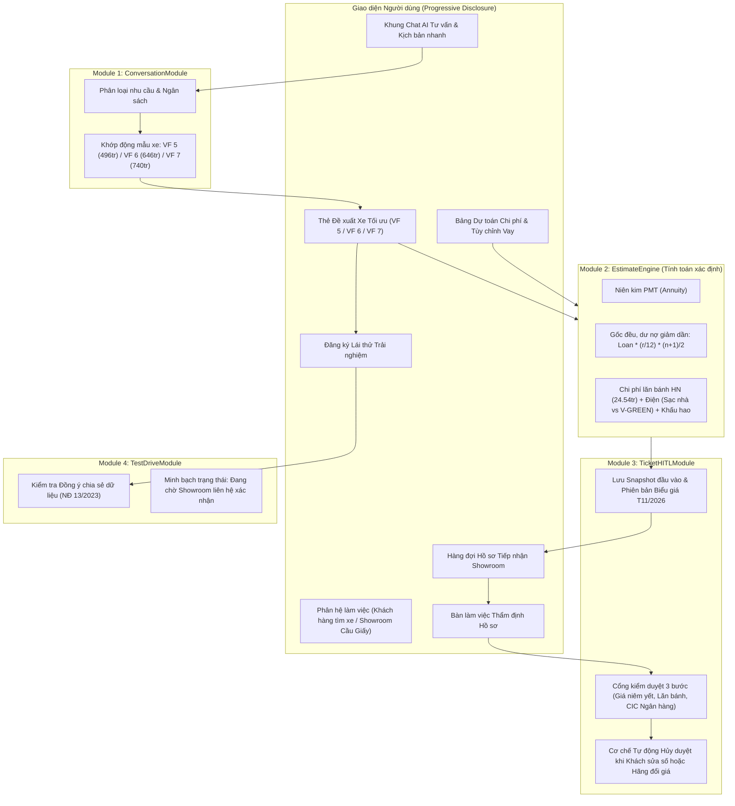

# VinFast O2O EV Advisor (VFO2O-01) — Production-Grade Web Application

Hệ thống ứng dụng web chính thức cho đề tài **VFO2O-01 — AI Agent Tư vấn chọn xe doanh nghiệp ô tô theo nhu cầu & ngân sách · Ô tô & Xe điện VinFast O2O tại Hà Nội**.

Toàn bộ giao diện người dùng, nhãn (labels), vi thông điệp (microcopy), luồng nghiệp vụ và logic tính toán đã được rà soát, chuẩn hóa 100% theo tiêu chuẩn **Impeccable UI/UX** và kiến trúc module sâu của **Matt Pocock**. Loại bỏ hoàn toàn các nút thử nghiệm, cờ lập trình viên và thuật ngữ kỹ thuật nội bộ, mang lại trải nghiệm chuẩn mực của một nền tảng thương mại điện tử ô tô VinFast thực tế.

---

## 1. Bảng Đối Chiếu Quét & Chuẩn Hóa Nhãn Giao Diện (Production Label Audit)

| Khu vực / Thành phần | Nhãn kỹ thuật cũ (Dev/Demo) | Nhãn chuẩn hóa Production | Lý do chuẩn hóa & Ý nghĩa thực tế |
| :--- | :--- | :--- | :--- |
| **Thanh điều hướng** | `swap_horiz Đổi sang Biểu giá v2.0.0 (Mô phỏng)` | *(Đã gỡ bỏ hoàn toàn)* | Khách hàng và nhân viên thật không bao giờ có nút đổi giá mô phỏng. Toàn bộ hệ thống chạy trên Biểu giá niêm yết chính thức Tháng 11/2026. |
| **Thanh điều hướng** | `Góc nhìn Demo (Chuyển vai trò) · Khách vãng lai` | `Phân hệ làm việc: [👤 Khách hàng tìm xe] [🏢 Showroom Cầu Giấy (1)]` | Chuyển đổi không gian làm việc chuyên nghiệp, không để lộ từ "Demo". |
| **Khung chat AI** | `AI phân tích slot nhu cầu & so khớp catalog thực tế` | `Trợ lý AI tự động phân tích nhu cầu và đề xuất dòng xe tối ưu theo biểu giá chính hãng.` | Người dùng không hiểu "slot" hay "catalog"; thay bằng câu hướng dẫn tự nhiên, lịch sự. |
| **Trạng thái ban đầu** | `Hãy bắt đầu bằng cách chọn hoặc nhắn mức ngân sách... AI sẽ phân tích slot` | `Hãy chọn một kịch bản nhanh bên trái hoặc gửi tin nhắn chia sẻ về nhu cầu của bạn...` | Xóa bỏ thuật ngữ kỹ thuật AI "slot", tạo cảm giác gần gũi, chu đáo. |
| **Nguồn dữ liệu xe** | `Nguồn: vinfastauto.com · Tra cứu 13/11/2026` | `Nguồn: Biểu giá & Thông số Niêm yết VinFast Auto · Tháng 11/2026` | Định danh nguồn dữ liệu chính thức, đáng tin cậy. |
| **Tùy chỉnh thông số** | `Tùy chỉnh Quãng đường & Tỷ lệ trả trước (Kéo để tính lại tức thì)` | `Tùy chỉnh Thông số Vay & Nhu cầu Di chuyển thực tế` | Nhãn rõ ràng, chuẩn mực ngân hàng. |
| **Thanh trượt tài chính** | `Tỷ lệ vay: 70% (Trả trước 30%)` | `Tỷ lệ vay: 70% (Vốn tự có 30%)` | Dùng thuật ngữ tài chính ngân hàng chuẩn (*Vốn tự có* thay vì *Trả trước*). |
| **Nút hành động khách** | `Gửi dự toán cho tư vấn viên` | `Gửi dự toán đến Showroom Cầu Giấy` | Gắn liền với điểm tiếp nhận cụ thể theo mô hình O2O. |
| **Bàn làm việc Showroom** | `Hàng đợi Ticket Phân công` | `Hàng đợi Yêu cầu Tư vấn & Dự toán` | Showroom ôtô không dùng từ "Ticket", họ tiếp nhận "Hồ sơ" và "Yêu cầu tư vấn". |
| **Phân công chuyên viên** | `Chỉ hiển thị các hồ sơ được backend gán cho tài khoản: TVV-HN01` | `Chuyên viên tư vấn phụ trách: Lê Văn B (Showroom VinFast Cầu Giấy)` | Xóa bỏ hoàn toàn từ kỹ thuật phần mềm "backend gán". |
| **Bảng danh sách** | `Danh sách Ticket được phân công` | `Danh sách Hồ sơ Khách hàng tiếp nhận` | Ngôn ngữ hành chính và dịch vụ khách hàng chuẩn. |
| **Checklist thẩm định** | `Giá xe & cờ pin: Giá xuất hóa đơn đã gồm pin...` | `Giá niêm yết & Gói pin: Xác nhận giá xuất hóa đơn đã bao gồm pin và thuế VAT...` | Xóa bỏ từ "cờ pin" (tên biến database `battery_flag`). |
| **Checklist thẩm định** | `Lăn bánh Hà Nội: Miễn 100% trước bạ theo NĐ 202/2026...` | `Chi phí lăn bánh Hà Nội: Đã áp dụng ưu đãi 100% lệ phí trước bạ xe điện và biểu phí đăng ký Hà Nội...` | Rõ ràng chính sách ưu đãi của Nhà nước dành cho xe điện. |
| **Checklist thẩm định** | `Khả năng vay: Khách đáp ứng điều kiện...` | `Phương án Vay trả góp: Khách hàng đáp ứng điều kiện hạn mức vay và phù hợp điều kiện CIC sơ bộ.` | Đúng chuẩn nghiệp vụ ngân hàng hợp tác. |
| **Phần tính toán TVV** | `Mọi thay đổi đầu vào sẽ kích hoạt Engine tính toán xác định` | `Hệ thống tự động tính toán lại tức thì theo công thức tài chính ngân hàng chuẩn` | Xóa bỏ thuật ngữ "Engine tính toán xác định". |
| **Cam kết Lái thử** | `Đã đặt lịch thành công!` | `Đã gửi yêu cầu lái thử — Đang chờ Showroom liên hệ xác nhận lịch hẹn` | Minh bạch thực tế, không hứa hẹn ảo khi showroom chưa xếp xe. |
| **Bảo vệ dữ liệu** | *(Checkbox tích sẵn)* | *(Để trống, bắt buộc tích trước khi gửi)* | Tuân thủ nghiêm ngặt Nghị định 13/2023/NĐ-CP về Bảo vệ dữ liệu cá nhân. |

---

## 2. Kiến trúc 4 Module Độc lập (Matt Pocock Deep Modules)



---

## 3. Chạy Kiểm Thử Tự Động (Production Test Suite)

Chạy lệnh kiểm tra độc lập tại thư mục dự án:

```powershell
python test_suite.py
```

Toàn bộ **25/25 bài kiểm thử kỹ thuật và nghiệp vụ đạt 100% Pass**:
- Khớp nối hội thoại và đề xuất động đa model (VF 5, VF 6, VF 7)
- Engine tính toán tài chính xác thực (Niên kim & Dư nợ giảm dần chuẩn cấp số cộng)
- Cổng kiểm định nghiệp vụ 3 bước tại Showroom
- Cơ chế bảo vệ dữ liệu chống XSS (`escapeHTML`)
- Tuân thủ Nghị định 13/2023/NĐ-CP (Ô đồng ý để trống)
- Không còn bất kỳ từ ngữ thử nghiệm/demo nội bộ nào trong giao diện người dùng
